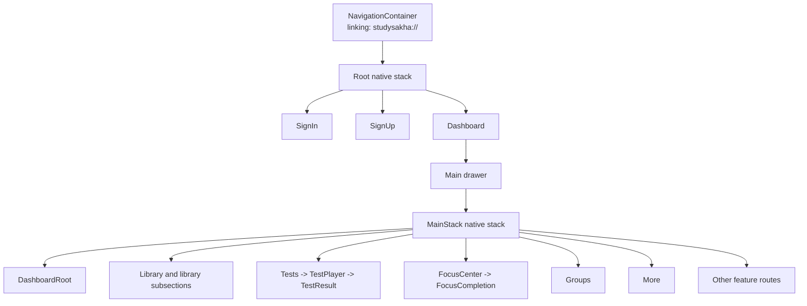

# Study Sakha navigation architecture

Audit date: 2026-11-24

This document records the navigation architecture verified in source, the safe changes made in this audit, and the remaining device-validation boundaries. The implementation intentionally keeps the existing screens, headers, drawer, bottom navigation, themes, animations, and business workflows unchanged.

## 1. Current architecture

`StoreProvider` owns authentication and persistent business state. `ThemeProvider` owns visual mode and text scale. React Navigation owns navigation state; no second navigation persistence store is used. The authenticated tree is mounted only after store hydration and auth readiness, so logout removes the authenticated navigator tree.

Verified source: [App.tsx](../App.tsx), [lib/navigation.ts](../lib/navigation.ts), [components/Shell.tsx](../components/Shell.tsx), and the screen registrations in [App.tsx](../App.tsx).

## 2. Final hierarchy and route inventory

| Route | Parent | Entry points | Back target / policy | State and chrome |
|---|---|---|---|---|
| `SignIn` | Root stack | Cold start, logout | System/auth flow | Auth screen; no app chrome |
| `SignUp` | Root stack | Sign in | `SignIn` | Auth screen; no app chrome |
| `DashboardRoot` | MainStack | Auth success, Home/logo, drawer/tab Home | Root: Android exit policy | Preserves store state; existing Shell |
| `Library` | MainStack | Home, Shell navigation, drawer/links | Dashboard or prior stack route | Library filters remain in route/store state |
| `LibraryNotes` | MainStack | Library | `Library` | Library chrome |
| `LibraryBooks` | MainStack | Library | `Library` | Library chrome |
| `LibraryPYQSets` | MainStack | Library | `Library` | Library chrome |
| `LibraryStarred` | MainStack | Library | `Library` | Library chrome |
| `LibraryDownloads` | MainStack | drawer, Library | `Library` | Library/download state persists |
| `BookReader` | MainStack | Library/Search | Previous meaningful route; native back uses stack history | Detail header; reading page/font state stays mounted during mode changes |
| `NoteEditor` | MainStack | Library/Search/Dashboard/Current Affairs | Previous meaningful route; save is explicit in existing UI | Draft fields are screen state; saved notes use StoreProvider |
| `PYQ` | MainStack | Library, Home, reader | Dashboard or prior stack route | Existing Shell |
| `Tests` | MainStack | Home, Library, Profile, Notifications | Dashboard or prior stack route | Existing Shell |
| `TestPlayer` | MainStack | Tests, Search, Dashboard, Current Affairs | Existing confirmation; leaving preserves saved attempt | Active answers/deadline in user-scoped AsyncStorage |
| `TestResult` | MainStack | TestPlayer, Tests | `Tests` | Result in StoreProvider; solutions/review remain in result screen |
| `Groups` | MainStack | Home, Settings, Focus | Internal group screen first, then Dashboard | Group detail/room state is screen-owned; existing back listener is focused |
| `More` | MainStack | Existing section entry | Dashboard or prior stack route | Existing Shell |
| `SakhaAI` | MainStack | Shell, result, Home | Previous AI context/stack | Conversation state is store/screen-owned |
| `CurrentAffairs` | MainStack | Home/Shell | Dashboard or prior stack route | Existing Shell |
| `Search` | MainStack | Shell | Dashboard or prior stack route | Search query is screen state |
| `Notifications` | MainStack | Header, deep notification response | Previous section or Dashboard | Inbox in StoreProvider; tap routes retain safe fallback |
| `Statistics` | MainStack | Shell, Focus completion, Profile | Dashboard or prior stack route | Derived stats and history persist in store/storage |
| `TaskPerformance` | MainStack | Statistics | `Statistics` | Date range is route params |
| `StudyPlanner` | MainStack | Home, Profile, Settings | Dashboard or prior stack route | Date/tasks/settings persist through store/storage |
| `FocusCenter` | MainStack | Home, planner, groups | Origin (`DashboardRoot`/`Groups`) after confirmation | Active session is timestamped and persisted |
| `FocusCompletion` | MainStack | FocusCenter completion | Origin, or explicit existing action | Completion record is passed in route and recorded once |
| `FocusLock` | MainStack | Home/settings | Existing Focus Lock behavior | Native snapshot/session state persists |
| `Profile` | MainStack | Drawer/Shell | Dashboard or prior stack route | Store-backed profile |
| `Settings` | MainStack | Drawer/Shell/Profile | Dashboard or prior stack route | Store-backed settings |
| `AppGuide` | MainStack | Drawer/Settings | Previous route; explicit Settings action remains | Existing Shell |
| `Admin` | MainStack | Admin-only Shell entry | Dashboard or prior stack route | Existing access checks |

The Groups screen also contains internal `main`, `detail`, and `notifications` views plus study-room context. These are intentionally screen state rather than additional navigator routes, preserving the existing room identity and UI. Book Reader has `overview` and `read` modes in the same route. Test Player has the question palette and confirmation overlays in the same route.

## 3. Back behavior

React Navigation owns ordinary back behavior. The existing `useSmartAndroidBack` hook is focus-scoped and is used only by detail/workflow screens that need a contextual stack target. Drawer-open state is delegated back to the drawer. Header back buttons call the screen's existing navigation action.

The route helper in [lib/navigation.ts](../lib/navigation.ts) maps library subsections to Library, test routes to Tests, task performance to Statistics, and contextual detail screens to the previous stack route where available. The stack's `popTo` action prevents accumulating duplicate section routes when the existing Shell navigation controls are used.

### Critical workflow rules

- **Test Player:** Android back, system back, and the existing close control use the existing confirmation surface. “Leave test” does not submit or delete the attempt; the answer/index/deadline snapshot remains available for resume. Only Submit dispatches result/scoring logic.
- **Focus Centre:** the existing `beforeRemove` and focused back handler request confirmation while a session exists. Its persisted timestamp/session record remains the source of truth across navigation and AppState changes. Completion is guarded by the existing finalization path.
- **Note Editor:** the existing explicit Save action and StoreProvider persistence remain unchanged. No duplicate note path was introduced.
- **Planner, Groups, and AI:** existing screen/store state remains in place; no route reset was added that could discard date, room, conversation, or attachment context.

At `DashboardRoot`, Android back is handled only while that screen is focused: the first press shows the existing platform toast and a second press within two seconds returns `false`, allowing the Android default exit/background behavior. Non-root routes are not intercepted by this policy.

## 4. Modal and overlay policy

Existing React Native `Modal`, bottom-sheet, popup, and selection-overlay handlers remain screen-owned. Their `onRequestClose`/back paths dismiss the topmost overlay before navigation where implemented. No global modal manager or new navigation UI was added. Focus and test overlays retain their existing confirmation requirements.

## 5. Restoration and deep links

Startup waits for StoreProvider hydration and auth readiness before rendering the authenticated navigator. Invalid stored business records are rejected by their existing validators. Navigation state is not blindly persisted or replayed, avoiding stale authenticated routes after logout.

The existing React Navigation linking configuration in [App.tsx](../App.tsx) supports `studysakha://` and route paths for auth, Dashboard, sections, tests, focus, library, planner, and account screens. Notification responses are queued until the container is ready and currently route to the existing Notifications inbox. Unsupported or malformed notification data is ignored safely by [getNotificationNavigationRoute](../lib/navigation.ts).

Known limitation: notification payloads currently expose only the existing Notifications destination; group/test/article/message-specific destinations need a stable payload contract before they can be routed safely.

## 6. Audit findings and changes

Findings:

- The navigator hierarchy and route registrations were already type-centralized and had no duplicate registrations.
- The active test player called the generic Android back hook without connecting it to its existing confirmation state; this could leave an active attempt immediately.
- Focus and Groups use focused, cleaned-up back listeners for their internal workflows; they were not replaced because they carry workflow-specific behavior.
- There is no second navigation persistence system, and no indiscriminate root reset was found in the inspected app navigation.
- Device-only validation is still required for hardware back, gesture back, deep links, and cold-start notification taps.

Implemented:

- Connected Test Player Android back to the existing confirmation surface and preserved the saved attempt on exit.
- Added focused Dashboard root double-back exit behavior using Android's existing toast/back APIs.
- Added this architecture, matrix, Mermaid diagram, workflow policy, and limitation record.

Modified files: [screens/TestPlayerScreen.tsx](../screens/TestPlayerScreen.tsx), [screens/DashboardScreen.tsx](../screens/DashboardScreen.tsx), and this document. Existing unrelated worktree changes were preserved.

## 7. Verification

| Check | Result |
|---|---|
| Route/source audit | Completed |
| Existing navigation tests | PASS — full Jest suite before final matrix assertions: 30 suites, 114 tests; final focused navigation suite: 7/7 |
| TypeScript | PASS — `pnpm exec tsc --noEmit --pretty false` |
| Lint | PASS — `pnpm exec expo lint` |
| UI visual changes | None intentionally introduced; device screenshot review not available |
| Android hardware/gesture back | Not device-tested in this environment |
| Cold-start deep link/notification | Not device-tested in this environment |

## 8. Known limitations

- Android device testing is required for gesture-back dispatch ordering, toast timing, app exit/background behavior, drawer gestures, and notification cold starts.
- The app delegates hosted book files to the platform URL handler; this audit does not introduce a new PDF viewer.
- Existing screen-local drafts, modal state, and scroll positions are not converted into a new global persistence layer; doing so would risk changing the current experience.
- Notification routing beyond the existing inbox is not implemented without a payload/data contract.
